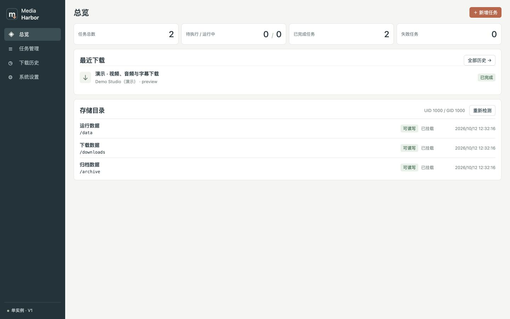
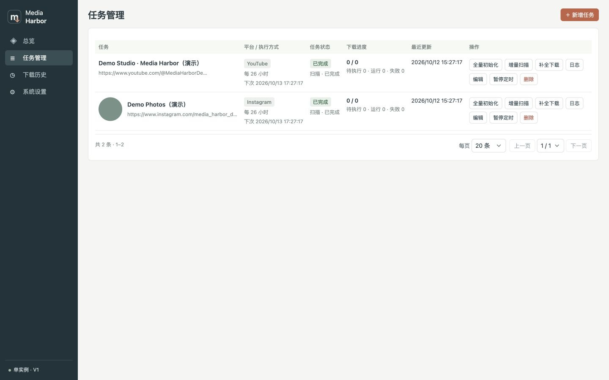
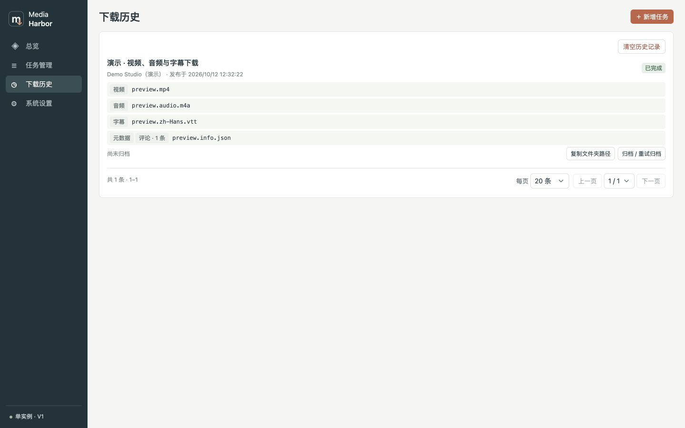
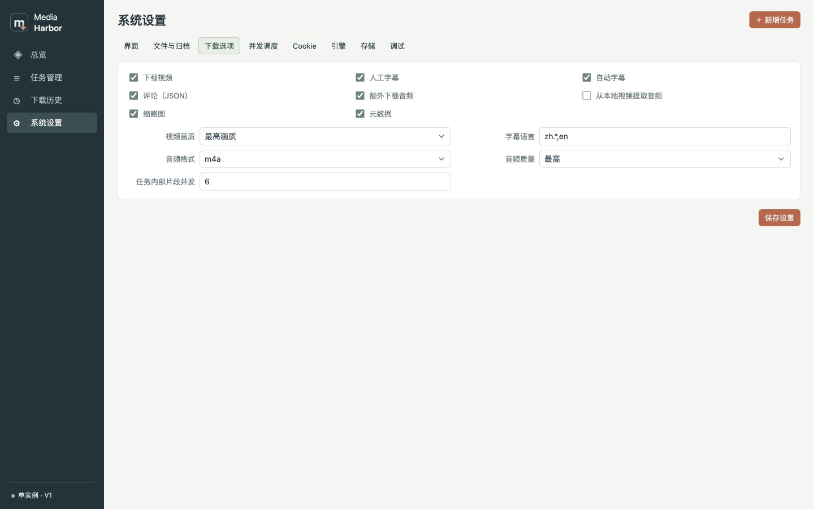

<p align="center">
  <strong>简体中文</strong> · <a href="README.en.md">English</a> · <a href="README.hi.md">हिन्दी</a> · <a href="README.ru.md">Русский</a> · <a href="README.ja.md">日本語</a>
</p>

# Media Harbor

将 YouTube 和 Instagram 的内容下载到自己的设备，按博主与日期整理文件，并持续获取主页的新内容。

## 能做什么

- 下载单个视频、帖子，或定期检查博主主页。
- 创建任务前可点击 Dryrun 验证请求，实时查看日志；不创建任务、不保存文件，关闭日志窗口即可停止。
- YouTube 默认保存最高画质 MP4 和额外 m4a 音频，可选择字幕、评论、缩略图与元数据。
- 跳过已下载内容；补全下载复用已有文件，补齐缺项并刷新所选评论与元数据。
- 在同一界面查看任务状态、进度、日志和下载历史，支持取消、重试与重启后继续执行。
- 按目录规则保存文件，可自动归档；界面支持中文、英文、印地语、俄语和日语。

## 功能预览

Docker 环境中的 PC 横屏预览，使用演示数据。



<details>
<summary>查看其他主要页面</summary>

**任务管理**



**下载历史**



**系统设置**



</details>

## 启动

### 方案一：直接拉取镜像（推荐）

安装 Docker 后即可使用，不需要下载源码。镜像首次发布后执行：

```sh
docker pull ghcr.io/leapsea/media-harbor:latest
mkdir -p data downloads archive logs
```

Linux 上，运行容器前先设置目录所有者：`sudo chown -R 1000:1000 data downloads archive logs`。镜像默认使用 `1000:1000` 用户。

```sh
docker run -d --name media-harbor \
  --restart unless-stopped \
  -p 8080:8080 \
  -v "$PWD/data:/data" \
  -v "$PWD/downloads:/downloads" \
  -v "$PWD/archive:/archive" \
  -v "$PWD/logs:/logs" \
  -e TZ=Asia/Singapore \
  ghcr.io/leapsea/media-harbor:latest
```

打开 [http://localhost:8080](http://localhost:8080)。示例挂载了全部目录，不需要归档或保留日志时，可去掉对应的 `-v` 参数。

| 宿主机目录 | 保存内容 | 是否必须挂载 |
| --- | --- | --- |
| `data` | 任务、设置、Cookie 与下载索引 | 启动非必需；长期使用建议挂载，以便重建容器后保留状态 |
| `downloads` | 下载文件 | 启动非必需；建议挂载，以便在宿主机访问和保留下载文件 |
| `archive` | 归档文件 | 启用归档时必须挂载，且目录可写 |
| `logs` | 任务日志 | 可选；挂载后可在宿主机查看并保留日志 |

未挂载目录的内容存放在容器内，删除容器后不会保留。更换端口可修改 `-p 8080:8080` 的第一个端口，目录路径可替换为自己的存储位置。

### 方案二：拉取源码并构建

安装 Docker、Compose 和 Git 后执行：

```sh
git clone https://github.com/leapsea/media-harbor.git
cd media-harbor
cp .env.example .env
mkdir -p data logs downloads archive
```

Linux 上，启动前先按 `.env` 中的 `PUID` / `PGID` 设置目录所有者，默认可执行 `sudo chown -R 1000:1000 data logs downloads archive`。自定义用户见 [部署文档](docs/部署与开发.md#docker-配置)。

```sh
docker compose up -d --build
```

## 创建第一个任务

### 下载单个视频或帖子

1. 打开“任务管理”，点击“新增任务”。
2. 选择平台，粘贴视频或帖子地址，确认自动解析的目录名称。
3. 按需选择下载内容并保存。详情地址会立即执行一次。
4. 在任务列表查看进度；完成后，在“下载历史”查看产物，点击复制按钮获取文件夹路径。

### 持续下载博主主页

1. 新增任务时粘贴博主主页地址，设置目录名称与执行间隔，保存。
2. 点击“全量初始化”，下载当前可获取的内容。创建主页任务只保存配置，不自动开始下载。
3. 首次手动执行后启动周期，后续扫描只排队新增内容。可暂停或恢复定时执行。

Instagram 与 YouTube 各自按入队顺序执行，每个平台同一时间只处理任务管理中的一个博主配置。当前批次的扫描和媒体下载全部结束后，才开始下一个配置；定时到期、手动启动和重试均需排队。两个平台可以同时执行，各自的并发设置控制当前博主内部的媒体下载数量。当前平台批次会持久保存，服务重启后先继续该批次。

两个平台分别使用“单生产者 → 有界等待队列 → 多下载消费者”。生产者串行获取和解析帖子、视频及头像信息；下载并发按同时处理的媒体条目计，只控制最终媒体传输；YouTube 单个视频内部的片段并发继续由下载选项单独控制。等待队列默认最多 10 条，不包含正在运行的消费者；队列达到上限后停止确认当前条目，消费者取走任务后才继续获取下一条。YouTube 在入队前准备完整格式信息，消费者复用该信息；恢复任务或过期地址的重新解析也进入同一平台生产者。

“系统设置 → 并发调度”可以调整各平台下载并发、请求滑动窗口、窗口请求上限、最小间隔、429 默认冷却，以及等待队列上限、Instagram 地址缓存有效期和容量。默认窗口为 60 秒/20 次，Instagram 最小间隔 6 秒，YouTube 3 秒；两者的 429 默认冷却均为 60 秒。预算统计解析 SDK 请求，包含分页与重试，Instagram 的重定向请求也计入；媒体 CDN 传输不消耗该预算。收到 429 优先遵循 `Retry-After`，后续解析和媒体重试都遵守同一平台冷却；Instagram SDK 的额外默认等待由 Go 接管。两个平台的时钟和冷却互不影响。保存设置后等待中的请求重新判断预算，已运行下载不被取消。

旧 `INSTAGRAM_REQUEST_INTERVAL_SECONDS` 与 `INSTAGRAM_429_COOLDOWN_SECONDS` 仅用于首次初始化或旧库新增字段的迁移，此后以系统设置为准。Instagram 默认缓存 64 条、有效期 60 分钟；地址被明确拒绝时仍只刷新一次。节流减少请求叠加，但不能保证平台不再限流。

请求调度、网页媒体解析、字节进度及试运行验证策略由 Go 实现；Python 仅保留 gallery-dl/yt-dlp SDK 的元数据、会话、流读取和只读适配。旧 `dryrun.py` 与 `instagram_progress.py` 保留为历史参考，正式业务不再执行这些旧脚本。

| 操作 | 使用场景 |
| --- | --- |
| 全量初始化 | 首次获取主页内容 |
| 增量扫描 | 从最新内容开始，仅下载本地没有的新内容；遇到首个已有媒体即停止后续历史检查。无本地索引时可用于首次下载 |
| 补全下载 | 遍历可获取的历史内容，对比本地索引与文件；补齐遗漏内容及缺失产物，刷新所选评论和元数据 |
| 重试 | 重新执行失败任务 |

“下载历史”按实际文件展示视频、音频、字幕等标签。评论保存在元数据 JSON 中，与元数据标签对应同一文件。“清空历史记录”只清除展示记录，保留文件与下载索引，后续扫描仍会跳过已有内容。

## 常用配置

大部分配置在“系统设置”中完成，修改后点击“保存设置”。

| 设置 | 用途 |
| --- | --- |
| 下载 | 调整平台并发及 YouTube 默认下载内容；任务可单独覆盖下载选项 |
| 目录规则 | 调整目录模板、日期来源与自动归档；归档目录需要挂载且可写 |
| Cookie | 编辑并粘贴浏览器 Cookie；保存后扫描与下载自动使用 |
| 界面 | 切换语言、总览最新下载数量、列表每页条数 |
| 存储 | 查看占用、清空日志、清理已完成及无关联任务的缓存 |
| 调试 | 开启条目限制，先处理少量内容验证流程；关闭后处理全部内容 |

Instagram 头像按稳定作者 ID 共用文件，后缀使用实际图片格式（如 `.jpg`、`.png`、`.webp`）。启动时会将下载、归档目录中可识别的旧 `.img` 头像原地重命名，不重新下载、不改变内容或修改时间；头像大小相同仍保留原图。

默认目录规则为 `{platform}/{directory_name}/{year}/{month}{day}/{filename}`。日期默认使用网站上传或发布时间，缺失时使用任务创建日期，按本地时区计算。

直接运行镜像时通过启动参数调整端口、路径与时区；源码 Compose 部署则修改 `.env`。平台访问失败时，可先查看任务日志；下载结果取决于网络、平台访问条件和可获取的内容。

## 文档

- [v1.0.0 已实现功能](docs/versions/v1.0.0.md)
- [部署、开发与版本发布](docs/部署与开发.md)
- [架构说明](docs/V1-架构.md)
